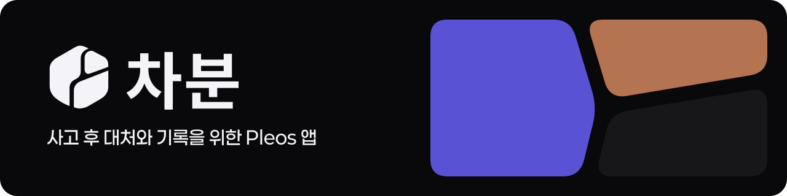

## 구성

- [Release v1.0.0](https://github.com/JangHyun-bin/chabun/releases/tag/v1.0.0)
- [서명 APK](https://github.com/JangHyun-bin/chabun/releases/download/v1.0.0/chabun-1.0.0.apk)
- [SHA-256](https://github.com/JangHyun-bin/chabun/releases/download/v1.0.0/SHA256SUMS)

## 실행과 시연

차량용 APK는 서버 없이 실행됩니다. 휴대폰 연결은 별도 환경에서 시연합니다.

충돌 장면·예시 경위서·기관 처리 결과는 시연입니다.

자세한 내용은 [기능 범위와 제한](docs/submission.md)을 참고해주세요.

## 빌드와 설치

공식 Pleos Connect Emulator(Pleos Connect v2.1.0 시스템 이미지, API 34)에서 실행합니다. 화면 규격은 2560×1440(160dpi)이며, 앱은 그 안의 앱 창 1682×1210에서 실행합니다.

개발 환경은 Node.js 22.12 이상, JDK 21, Android SDK 35, Build Tools 36.0.0입니다.

[빌드·설치 방법](docs/build.md)과 [검증 기록](docs/verification.md)을 참고해주세요.

## 라이선스

라이브러리·폰트·UI 구성 요소의 라이선스는 [제3자 고지](THIRD_PARTY.md)를 참고해주세요. 자체 소스에는 별도의 재사용 라이선스를 부여하지 않습니다.
